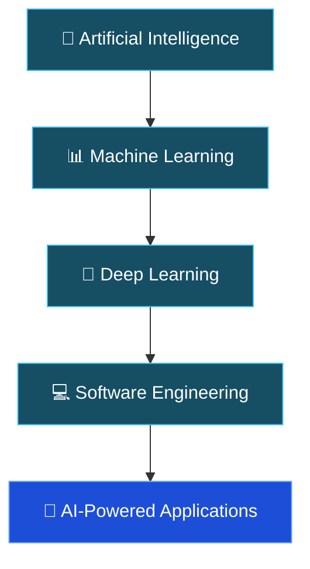

 

---

## 👋 Hi, I'm Waseem!

I'm a Software Engineer and AI/ML developer based in Lahore, Pakistan, with a Bachelor's degree in Computer Science from The University of Lahore.

I enjoy building intelligent applications that combine machine learning, language models, computer vision, and modern software engineering.

My work focuses on turning AI concepts into practical applications, from AI-powered recruitment systems and retrieval-augmented generation to predictive analytics and full-stack platforms.

I believe in learning by building, solving real problems, and continuously improving the way software is designed and developed.

---

## 🧠 What I Work On

<table>
  <tr>
    <td width="50%" valign="top">
      <h3>🤖 Artificial Intelligence</h3>
      
I explore AI-powered applications using Large Language Models (LLMs), Retrieval-Augmented Generation (RAG), multi-agent systems, and Natural Language Processing (NLP) to build intelligent solutions that understand context, retrieve information, and automate complex tasks.

    </td>
    <td width="50%" valign="top">
      <h3>📊 Machine Learning</h3>
      
I work on predictive modeling, data preprocessing, model training, and evaluation, applying machine learning and deep learning techniques to identify patterns, generate insights, and develop data-driven solutions, including computer vision applications.

    </td>
  </tr>
  <tr>
    <td width="50%" valign="top">
      <h3>💻 Software Engineering</h3>
      
I develop web applications and backend services using Python, FastAPI, and React.js, with experience in RESTful API development, WebSockets, database integration, and building responsive applications with structured and maintainable code.

    </td>
    <td width="50%" valign="top">
      <h3>⚡ Applied AI Systems</h3>
      
I focus on integrating AI into practical software solutions, including intelligent recruitment platforms, environmental prediction systems, business analytics, AI-assisted automation, and real-time applications that connect machine learning capabilities with modern software development.

    </td>
  </tr>
</table>

---

## 🎓 Education

<table>
  <tr>
    <td valign="top">
      <h3> Bachelor of Science in Computer Science</h3>
      <b>The University of Lahore</b> · Lahore, Pakistan 
      📅 February 2022 – February 2026  
      🏅 <b>CGPA:</b> 3.67 / 4.00
    </td>
  </tr>
</table>

---

## 💼 Professional Experience

<table>
  <tr>
    <td width="33%" valign="top">
      <h3>🤖 AI Intern</h3>
      <b>EnigmaDesk</b> 
      📍 Lahore, Pakistan 
      📅 Jul 2026 – Sep 2026
      
<small>Collaborated with the AI and Data Intelligence team, applying AI concepts to practical development tasks and gaining exposure to real-world AI workflows.</small>

    </td>
    <td width="33%" valign="top">
      <h3>🧠 AI/ML Trainee</h3>
      <b>NETSOL Technologies Limited</b> 
            📍 Lahore, Pakistan 
      📅 Mar 2026 – Jun 2026
      
<small>Trained in data preprocessing, predictive modeling, machine learning, NLP, LLMs, RAG, model evaluation, and fine-tuning.</small>

    </td>
    <td width="33%" valign="top">
      <h3>⚛️ React Developer Intern</h3>
      <b>Bright-Line Solutions (Pvt.) Ltd.</b> 
            📍 Lahore, Pakistan 
      📅 September 2025
      
<small>Developed practical frontend development skills using React.js, contributing to interface development and assigned application tasks.</small>

    </td>
  </tr>
</table>

---

## 🛠️ Technical Skills

### Programming Languages

### AI, Machine Learning & Data Science

### Web Development & Backend

### Databases, Cloud & Development Tools

### Additional Technologies

* **AI & NLP:** LLMs, RAG, LangChain, FAISS, Groq, model fine-tuning.
* **Computer Vision:** OpenCV, YOLOv8, object detection.
* **Backend:** FastAPI, Node.js, REST APIs, WebSockets.
* **Data:** Data preprocessing, predictive modeling, model evaluation.
* **Development:** Git, GitHub, Linux, Jupyter Notebook.

---

## 🌟 Featured Projects

### 01. 🧠 Harvard CS50 AI | Artificial Intelligence Portfolio

A collection of 12 practical AI projects completed as part of Harvard's CS50 Introduction to Artificial Intelligence with Python.

**Topics explored:**

* Search algorithms: Degrees
* Minimax game AI: Tic-Tac-Toe
* Propositional logic: Knights
* Knowledge-based AI: Minesweeper
* PageRank algorithm
* Bayesian networks: Heredity
* Constraint satisfaction: Crossword
* Supervised machine learning: Shopping
* Reinforcement learning: Nim
* Deep learning and CNNs: Traffic
* Natural language parsing: Parser
* Transformer attention: Attention

**Technologies:** Python, NumPy, TensorFlow, scikit-learn, NLTK, Transformers.

---

### 02. 🎯 HireGen-AI | AI-Powered Recruitment Platform

An AI-assisted recruitment platform designed to support resume screening, adaptive interviews, and structured candidate assessment.

**Key components:**

* AI-assisted resume screening and interview workflows.
* Dynamic interview functionality powered by Groq LLM.
* Computer vision integration with YOLOv8.
* Real-time communication using WebSockets.
* React.js frontend and FastAPI backend.
* Supabase storage and Azure deployment.

**Technologies:** Python, FastAPI, React.js, Groq LLM, YOLOv8, Supabase, WebSockets, Azure.

---

### 03. 📊 BizIntel | Business Intelligence & Sales Analytics

A full-stack business analytics platform designed to help monitor business performance through interactive dashboards and reporting.

**Key components:**

* Interactive revenue and sales visualizations.
* Executive KPI monitoring.
* Product performance tracking.
* Inventory anomaly alerts.
* JWT-based authentication.
* Database integration using Sequelize and MySQL.

**Technologies:** React.js, Vite, Chart.js, Node.js, Express.js, Sequelize, MySQL.

---

### 04. 🌍 Agentic AI | Real-Time Air Quality Prediction

An environmental intelligence system combining predictive machine learning, explainable AI, and multi-agent workflows.

**Key components:**

* XGBoost-based air quality prediction.
* SHAP-based model explainability.
* LangChain multi-agent framework.
* Asynchronous FastAPI backend.
* Streamlit dashboard.
* Simulated IoT sensor network.

**Reported model performance:** R² = 0.9929 | MAE = 0.85

**Technologies:** Python, XGBoost, SHAP, LangChain, FastAPI, Streamlit.

---

## 🧭 Current Focus

Currently focused on strengthening my machine learning and software engineering foundations while developing practical AI applications.

---

## 🏆 Achievements & Certifications

### Achievements

* Awarded a **50% merit-based tuition scholarship** throughout the BS Computer Science degree.
* Completed the CS50 AI portfolio consisting of 12 practical projects.

### Certifications & Training

| Certification / Program                  | Institution                 | Date           |
| ---------------------------------------- | --------------------------- | -------------- |
| Introduction to Artificial Intelligence  | The University of Lahore    | November 2025  |
| AI/ML Training, NAVTTC-Certified Program | NETSOL Technologies Limited | June 2026      |
| React Developer Internship               | Bright-Line Solutions       | September 2025 |

**Additional learning:** CS50's Introduction to Artificial Intelligence with Python, Harvard CS50.

---

## 🎯 Goals

* 🚀 Build practical AI and machine learning applications.
* 💻 Strengthen software engineering and backend development skills.
* 🏗️ Develop reliable, production-ready applications.
* 🌎 Contribute to open-source projects.
* 📚 Continuously explore emerging technologies.
* 🧠 Improve problem-solving and algorithmic thinking.

---

## 🌐 Languages

* English
* Urdu
* Punjabi

---

## 📊 GitHub Statistics

 

---

## 📌 All Projects & Repositories

Explore more of my development work:

| Project                       | Description                                     | Repository                                                                                  |
| ----------------------------- | ----------------------------------------------- | ------------------------------------------------------------------------------------------- |
| CS50 AI Portfolio             | 12 practical Artificial Intelligence projects   | [View](https://github.com/waseemqasim804-pk/Harvards-CS50-Artificial-Intelligence-Projects) |
| HireGen-AI                    | AI-powered recruitment and interview platform   | [View](https://github.com/waseemqasim804-pk/FYP-HireGenAI-AI-Powered-Interview-System)      |
| BizIntel                      | Business intelligence and sales analytics       | [View](https://github.com/waseemqasim804-pk/BizIntel-Business-Analytics-Platform)           |
| Agentic AI Air Quality        | Predictive environmental intelligence           | [View](https://github.com/waseemqasim804-pk/Agentic-AI-Air-Quality-Prediction)              |
| RAG Interview Assistant       | Retrieval-augmented interview assistant         | [View](https://github.com/waseemqasim804-pk/RAG-interview-assistant)                        |
| Full-Stack Application        | Modular web application                         | [View](https://github.com/waseemqasim804-pk/project1)                                       |
| Study Group Management System | Collaborative platform using React and Firebase | Project details in CV                                                                       |
| E-Learning Platform           | Interactive learning website                    | Project details in CV                                                                       |
| Car Parking System            | C++, OOP and data structures project            | Project details in CV                                                                       |

---

### 💬 Developer Quote

> First, solve the problem. Then, write the code.

 

### ⭐ Thanks for Visiting!

Thanks for exploring my profile. Feel free to browse my repositories, share feedback, or connect with me.

**Let's build something meaningful with technology.**

